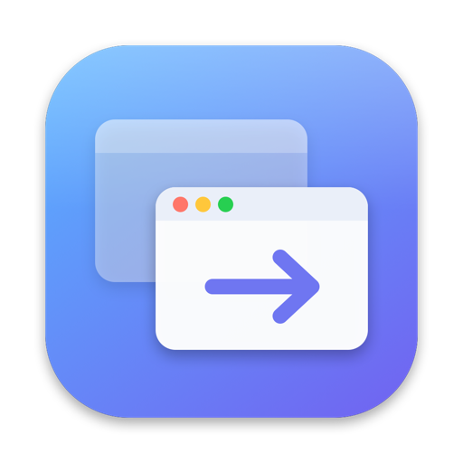

<p align="center">
  
</p>

<h1 align="center">Deck</h1>

<p align="center">
  A Cmd+Tab window switcher for macOS that looks like the system switcher but shows <b>every window</b>, not just every app.
</p>

<p align="center">
  <a href="https://github.com/henriksvendsgard/deck/releases/latest"><b>Download</b></a> ·
  <a href="#install">Install</a> ·
  <a href="#build-from-source">Build from source</a>
</p>

- Takes over **Cmd+Tab**: one item per window, most recently used first
- Windows on **all Spaces**, plus minimized and hidden ones
- Optionally, apps running without windows go last with a small dot under them (off by default)
- Red **notification badges**, read from the Dock (optional)
- **Liquid Glass** look on macOS 26, measured against the system switcher
- **Cmd+Q** quits the selected app and **Cmd+W** closes the selected window, without leaving the switcher
- Opens at login, lives in the menu bar, no Dock icon
- No network access, no telemetry. A single Swift file

## Install

1. Download `Deck.zip` from the [latest release](https://github.com/henriksvendsgard/deck/releases/latest), unzip it and move **Deck.app** to **Applications**.
2. Open Deck. It is not notarized by Apple, so macOS blocks it the first time. Go to **System Settings → Privacy & Security**, scroll down and click **Open Anyway**.
   You can also remove the quarantine flag from Terminal instead:
   ```bash
   xattr -dr com.apple.quarantine /Applications/Deck.app
   ```
3. Grant access when asked: **System Settings → Privacy & Security → Accessibility → Deck**. When the menu bar icon says **Active**, Cmd+Tab is yours.

Requires macOS 14 or later. Liquid Glass needs macOS 26. Older versions get a blurred panel instead.

> **After updating** you have to grant Accessibility access again. Remove the old Deck entry with the minus button and add the new one. This happens because the app is not signed with an Apple Developer ID, so macOS sees every build as a new app.

## Use

| Keys | Action |
| --- | --- |
| Cmd+Tab / Cmd+Shift+Tab | Next / previous window |
| Release Cmd | Switch to the selected window |
| Arrow keys | Move the selection |
| Q / W (while holding Cmd) | Quit app / close window |
| Esc | Cancel |

A quick Cmd+Tab switches straight to the previous window without showing the panel, like the system switcher does. You can also click or hover with the mouse.

In the menu bar icon you can turn **Show Apps Without Windows**, **Show Notification Badges** and **Open at Login** on or off.

**If Cmd+Tab stops working** (for example if Deck crashed), this turns the system switcher back on:
```bash
/Applications/Deck.app/Contents/MacOS/Deck --restore
```
Logging out and in again fixes it too.

## Build from source

You need the Xcode Command Line Tools (`xcode-select --install`). Xcode itself is not needed.

```bash
git clone https://github.com/henriksvendsgard/deck.git
cd deck
./build.sh install
```

- `./build.sh` builds `build/Deck.app` (universal: Apple Silicon and Intel)
- `./build.sh install` also installs to `/Applications` and launches it
- `./build.sh release` makes `build/Deck.zip` for GitHub Releases
- `swift Tools/make-icon.swift` redraws the app icon
- `Deck --preview` shows the panel with your running apps for 8 seconds, without taking over Cmd+Tab

## How it works

- A `CGEventTap` catches Cmd+Tab, and the system hotkey is turned off while Deck runs. It is turned back on when Deck quits.
- Windows are listed with the Accessibility API. Windows on other Spaces are found in the background with the same element-ID technique [AltTab](https://github.com/lwouis/alt-tab-macos) uses.
- Focusing a window, finding windows on other Spaces and turning off the system hotkey use private SkyLight and HIServices functions. They are loaded at runtime, so Deck falls back to public APIs if they are missing.
- Badges are read from the Dock's accessibility tree.

## License

[MIT](LICENSE)
